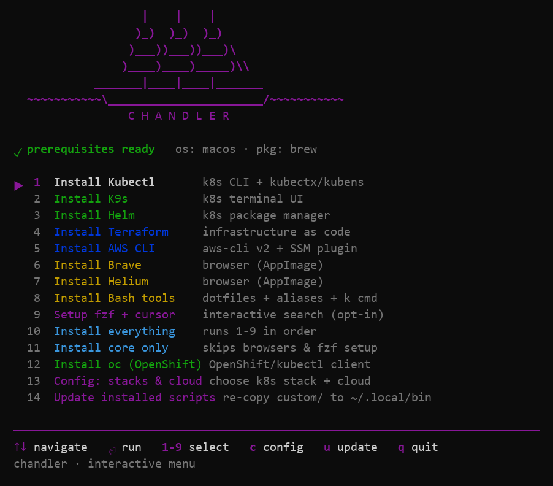
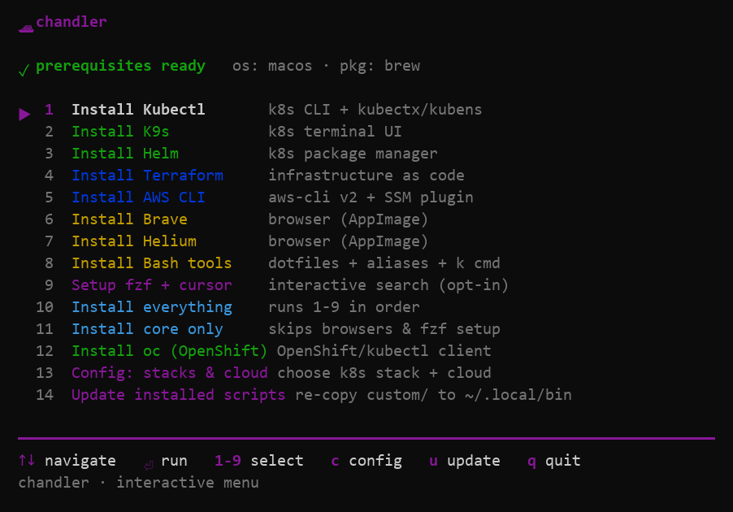
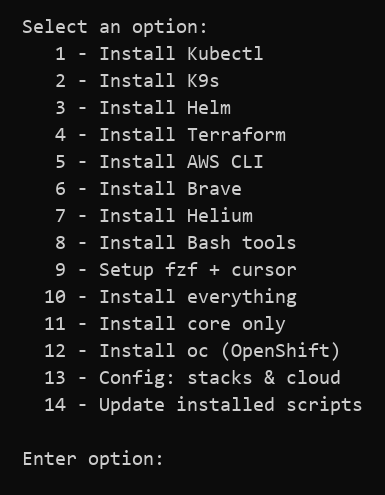

# chandler

A ship chandler outfits a vessel and its crew for the next leg — provisions,
spare parts, the equipment that keeps the ship working while it sits at the
dock. `chandler` does the same for a developer or ops machine: one
self-contained binary that detects the platform, checks its prerequisites,
asks the first-run questions, and then installs and wires up the everyday
toolkit — kubectl, k9s, helm, terraform, the AWS CLI, and more.



It is a Go port of this repo's original bash entrypoint: the same
prerequisite checks, the same `config.env` semantics, the same
`~/.local/bin` PATH block and the same exit codes — but the installers
themselves stay in bash and travel inside the binary, so there is no
checkout to drag around at runtime.

## Quick start

```sh
scripts/build.sh            # macOS / Linux (scripts\build.bat on Windows)
./chandler
```

No arguments opens the interactive menu. For a full artifact set (every
platform, packaged apps included) use the release script instead:

```sh
scripts/release.sh          # macOS / Linux
scripts\release.bat         # Windows
```

`.gitignore` already ignores the built binary.

## The menu

On startup the tool detects the OS, resolves the deployment root, loads
`config.env`, checks the installer prerequisites and prints the notes above
the menu. After that it picks a UI with the same gate the bash script used:
the **full-screen TUI** runs only when stdin and stdout are both terminals
and the window is at least 60×16; anything else falls back to the **numeric
menu**. The TUI also degrades to the fallback if raw mode cannot be entered.

On terminals shorter than 27 rows the ship banner collapses to a one-line
header:



### Key bindings

| Key | Action |
| --- | --- |
| `↑` / `↓` or `j` / `k` | move the selection |
| `g` / `Home`, `G` / `End` | jump to the first / last entry |
| `Enter` / `⏎` | run the selected entry |
| `1`–`9`, `0` | jump to entry N (10 for `0`); run it if already selected |
| `c` | re-run the stack/cloud config questions |
| `u` | sync the embedded custom scripts to `~/.local/share/chandler/scripts` |
| `q` / `Q` / `Ctrl-D` | quit |
| `Ctrl-C` | restore the terminal and exit |

After every action the menu redraws (the action's status is ignored, exactly
like the bash `run_menu_action "$sel" || true`).

### Fallback numeric menu

When there is no usable terminal the same 14 entries are offered as a plain
numbered prompt; an option outside `1`–`14` prints `Invalid option:
'<option>'.` and exits 1.



## What it installs

| # | Entry | What it does | Group |
| --: | --- | --- | --- |
| 1 | Install Kubectl | k8s CLI + kubectx/kubens | k8s |
| 2 | Install K9s | k8s terminal UI | k8s |
| 3 | Install Helm | k8s package manager | k8s |
| 4 | Install Terraform | infrastructure as code | cloud |
| 5 | Install AWS CLI | aws-cli v2 + SSM plugin | cloud |
| 6 | Install Brave | browser (AppImage) | app |
| 7 | Install Helium | browser (AppImage) | app |
| 8 | Install Bash tools | dotfiles + aliases + `k` command | app |
| 9 | Setup fzf + cursor | interactive search (opt-in) | setup |
| 10 | Install everything | runs 1–9 in order | bulk |
| 11 | Install core only | skips the browsers and the fzf setup | bulk |
| 12 | Install oc (OpenShift) | OpenShift / kubectl client | k8s |
| 13 | Config: stacks & cloud | choose the k8s stack + cloud | setup |
| 14 | Update installed scripts | re-copy `custom/` to `~/.local/share/chandler` | setup |

Every action dispatches to a bash installer with stdin/stdout/stderr
inherited, so each script's own prompts and output reach you unchanged.

## Subcommands

| Command | Behaviour |
| --- | --- |
| *(none)* | interactive menu (the default) |
| `update` | re-run the "Update installed scripts" action non-interactively, then refresh the installed `chandler` command |
| `install` | copy the binary that was run to `~/.local/bin/chandler` and record the root pin |
| `uninstall` | remove the installed command, the deployed scripts tree (`~/.local/share/chandler`), the root pin, the desktop entry and icons, and every config line chandler wrote; the Bash-tools dotfiles and `~/.aws/config` are restored from their `_bkp_` backups when one exists (credentials and shared tools like jq are never touched) |
| `version` | print `chandler <version> (<os>/<arch>, <go>)` — `dev` for a plain `go build` |
| `help` / `-h` / `--help` | print the usage |

Anything else exits 1 with a one-line error plus the usage on stderr. The
dispatch runs ahead of the config load and the prerequisite checks, so the
subcommands never pay for the interactive front end.

## Configuration

Two files under the deployment root drive the run:

- **`config.env`** — written by the first-run questions and by menu entry 13.
  It holds `CHANDLER_K8S_STACKS` and `CHANDLER_CLOUD_PROVIDERS`:
  ```sh
  export CHANDLER_K8S_STACKS="rancher"
  export CHANDLER_CLOUD_PROVIDERS="aws"
  ```
  Accepting a first-run question with nothing checked **proceeds with the
  defaults** (`rancher`, `none`) instead of cancelling, so a stray `Enter`
  never loses the config; cancelling (`Esc` / `q`) leaves the existing file
  untouched.
- **`tmp/`** — the scratch directory the child installers write into.

Environment variables:

| Variable | Purpose |
| --- | --- |
| `CHANDLER_ROOT` | deployment root, used verbatim |
| `CHANDLER_ROOT_PIN` | where the root-pin file lives |
| `CHANDLER_BASH` | the bash to run the installers with (Windows) |
| `CHANDLER_SELF` | path of the running binary, exported to the child scripts |
| `CHANDLER_CUSTOM_SCRIPTS` | explicit sync source for `customsync.ResolveSource` |

`NO_COLOR` disables the TUI's colours, as it does for the bash script.

## The deployment root

The tool always operates on a *deployment root* — the directory holding
`config.env` and `tmp/`. The original bash script assumed a fixed home;
the port resolves the root at startup, first match wins:

1. `CHANDLER_ROOT`, verbatim;
2. the executable's directory, when the root marker
   (`assets/scripts/install-kubectl.sh`, or `GO/…` in a nested checkout)
   is under it;
3. the parent of the executable's directory — the normal case, where the
   binary sits at the checkout root or in `release/`;
4. the pinned root (see below), same marker;
5. the current working directory, same marker;
6. the parent of the current working directory, same marker;
7. the last-resort default `$HOME/chandler`.

The marker validates the **checkout root**, never the Go module directory
itself. When candidate 2, 3, 5 or 6 wins, the root is best-effort persisted
to the pin so that the copy installed on the `PATH` keeps finding its
checkout. The pin file is `$CHANDLER_ROOT_PIN` when set, otherwise
`~/.config/chandler/path`; a stale or unreadable pin simply falls
through. One startup line is an addition over the bash script: right after
`Detected OS:`, the tool prints `Deployment root: <resolved path>`.

## Embedded assets

The binary is self-contained: every runtime asset is embedded at build time
with `//go:embed` from `assets/`:

- `assets/scripts/` — the bash installers (`install-<tool>.sh`,
  `update-scripts.sh`, `add_creds_to_aws.sh`);
- `assets/bash-files/` — the dotfiles (`bashrc`, `bash_function`,
  `bash_environment`, `aws_environment`, `commands_environment`);
- `assets/custom-scripts/` — the maintained helpers (`aws/`, `k8s/`, `tf/`,
  `misc/`, plus the AWS SSO `config` template).

`go build` therefore captures a new version of everything; the repo folders
are dev-time sources only. At startup the tree is materialized into a fresh
per-run temp directory (`$TMPDIR/chandler-assets-<random>`) — nothing is
reused across runs, so an upgraded binary always serves its own installers —
and removed just before the program exits. The menu dispatches installers
from that copy and exports `SCRIPT_DIR`, `SCRIPT_TMPDIR`, `ROOT`,
`BASHFILES_DIR` and `CHANDLER_SELF` for the child scripts. `.DS_Store` is
filtered out of both the extraction and the update sync.

## Custom scripts

The helpers behind the shell aliases live in `assets/custom-scripts/` — edit
them there, not in the deployed copy. Entry 14, the `u` key and the `update`
subcommand all sync the embedded `custom-scripts/` tree into
`~/.local/share/chandler/scripts`: new files are added, differing files
overwritten, exec bits preserved and `.DS_Store` skipped. Anything that
exists only in the destination is never deleted. The run lists each changed
item and ends with `Custom scripts: <n> item(s) updated.` (or
`already up to date.`). A pre-dataroot tree found at the old
`~/.local/bin/scripts` location is renamed whole into the new one first, so
hand-added scripts move along.

Everything chandler deploys lives in two places — the command at
`~/.local/bin/chandler` and the data root `~/.local/share/chandler/` — and
every line it writes into a shell config sits inside a
`# >>> chandler >>>` … `# <<< chandler <<<` marker block, so
`chandler uninstall` (or two `rm`'s and a block strip) removes the app
completely. The Bash-tools installer reaches a little further: it replaces
`~/.bashrc` with a template and copies the dotfiles home, keeping each
original as a `<name>_bkp_<timestamp>` backup, and points `~/.aws/config`
at the deployed scripts config — `chandler uninstall` restores the backups
and drops chandler's copies, while `~/.aws/credentials` and the other
installed tools in `~/.local/bin` are never touched.

## Release builds

`scripts/release.sh` (or `scripts/release.bat` on Windows) is a thin
wrapper around `go run ./tools/packager`, which builds the whole artifact
set into `release/` — stripped, static, cross-compiled binaries plus a
packaged app per platform — and writes a `SHA256SUMS` covering everything:

```sh
scripts/release.sh              # every target
scripts/release.sh linux        # only linux/* targets
scripts/release.sh darwin/arm64 # a single target
```

| Artifact | Platform |
| --- | --- |
| `chandler-darwin-arm64` / `-app.zip` / `.tar.gz` | macOS Apple Silicon (binary, app bundle, CLI tarball) |
| `chandler-darwin-amd64` / `-app.zip` / `.tar.gz` | macOS Intel (binary, app bundle, CLI tarball) |
| `chandler-linux-amd64` / `.tar.gz` | Linux x86-64 |
| `chandler-linux-arm64` / `.tar.gz` | Linux 64-bit ARM |
| `chandler-linux-arm` / `.tar.gz` | Linux 32-bit ARM |
| `chandler-windows-amd64.exe` / `.zip` | Windows x86-64 |
| `chandler-windows-arm64.exe` / `.zip` | Windows on ARM |

Each `-app.zip` unpacks to a `Chandler.app` carrying the icon, an
`Info.plist` and a launcher that hands the terminal UI to Terminal.app (the
bare binary sits in `Contents/Resources/`); the matching `.tar.gz` is the CLI
package — the bare binary, `chandler.icns` and a README. Each Linux `.tar.gz`
holds the binary, a `chandler.desktop` entry, the hicolor icon set and a
per-user `install.sh`. Each Windows `.zip` holds `chandler.exe`, `chandler.ico`
and a README, and the `.exe` files embed the icon in their PE resources via
the committed `rsrc_windows_*.syso` objects.

> **Unsigned artifacts.** Nothing here is code-signed, so Gatekeeper and
> SmartScreen warn on first run. On macOS clear the quarantine flag with
> `xattr -dr com.apple.quarantine /Applications/Chandler.app` (or
> `xattr -d com.apple.quarantine chandler-darwin-arm64` for the bare
> binary); on Windows choose *More info → Run anyway*, or build locally.

## Platform support

- **macOS / Linux** — the primary targets, fully supported on x86-64 and
  ARM. The TUI, raw-mode keystrokes and window-size probing use the
  termios / `TIOCGWINSZ` ioctls.
- **Windows** — supported as a first pass:
  - the installers are bash, so **bash must be on the PATH** and is located
    automatically (Git for Windows is searched, because a plain `bash` on
    Windows resolves to the WSL launcher); `CHANDLER_BASH` overrides it;
  - the **TUI needs a real console** (Windows Terminal, PowerShell, cmd).
    Git Bash's mintty pipes stdio, so the numeric menu runs there and the
    program prints a tip — prefix the command with `winpty` for the full TUI;
  - the prerequisite list shrinks to **jq alone** (curl and tar ship with
    Windows/Git Bash) and jq is direct-downloaded when missing;
  - the installers download Windows builds of kubectl, terraform, helm, k9s,
    oc, the AWS CLI (MSI) and fzf into `~/.local/bin`; Brave and Helium are
    Linux AppImages and self-skip with a pointer to their native installers;
  - the PATH block is appended to `~/.bashrc` and to both PowerShell
    profiles (marker-blocked and content-guarded, so re-runs never
    duplicate lines and `uninstall` can strip them);
  - the installed command is
    `%USERPROFILE%\.local\bin\chandler.exe` and the synced helpers land in
    `%USERPROFILE%\.local\share\chandler\scripts`.
- **FreeBSD / OpenBSD / NetBSD / DragonFly** — compiles and has the terminal
  plumbing, but is untested; package-manager detection reports none.
- Anything else (solaris, aix, plan9, js/wasm) does not compile.

## Design notes

**The installers stay bash.** The Go binary is the front door, not a rewrite
of everything behind it: every menu action runs
`bash <scriptDir>/install-<tool>.sh` with the layout exported, so the
scripts keep working standalone from a checkout too. The advantages over the
bash original are structural — one compiled entrypoint instead of a
`bash >= 4` script plus a checkout, embedded assets instead of a runtime
directory lookup, an in-process multi-select for the stack/cloud questions
(no external helper), a *discovered* deployment root instead of a hard-coded
one, and plain-text runner output that reads the same under the TUI and the
fallback menu. Everything else — prerequisite checks, `config.env`
semantics, the PATH block, the exit codes — follows the bash script.
